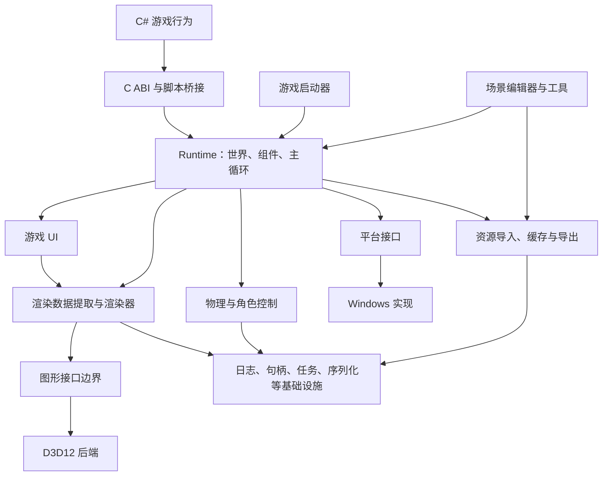

# 游戏引擎框架设计

> 版本：0.1｜需求基线日期：2026-10-22  
> 面向：独立开发、渲染开发岗位求职、公开源码标准的开发者工具  
> 状态：框架设计与开发计划，尚未实现或完成性能验证。文中的接口、目录和验收阈值属于设计方案。

## 1. 项目定位与交付边界

制作一款以 C++ 为核心、C# 为行为脚本语言的 3D 游戏引擎。引擎能够用于制作小型第一人称探索游戏，同时通过多个独立技术演示，展示 D3D12 渲染框架、GPU 资源管理和大量物体绘制的优化能力。

目标有两个：

1. **完整第一版**：其他开发者能够构建引擎、编辑场景、编写行为、制作屏幕空间 UI，并导出独立运行的 Windows 游戏。
2. **求职展示版本**：可运行的渲染演示、可复现的性能测试、清晰的技术文档和项目讲解材料。

两个目标都保留；发生进度冲突时，优先交付求职展示版本。完整第一版的必做功能不自动删除，需要与项目所有者确认延期或缩减，并在功能状态表中明确记录。

### 1.1 时间与资源

| 项目 | 已确定边界 |
|---|---|
| 开发人员 | 一人 |
| 时间投入 | 平日约每天两小时，周末可能增加 |
| 求职开始 | 2027-06-01 |
| 功能冻结目标 | 2027-05-01；冻结求职交付版本的新功能，转入修复、测量和材料整理 |
| 开发硬件 | Intel Core i7-12700H、16 GB RAM、RTX 3060 Laptop 6 GB |
| 基准条件 | 插电运行、1920×1080、固定画质与电源模式 |
| 普通场景目标 | 60 FPS；最终按固定演示场景和测量报告验收 |
| 开发与运行平台 | Windows 10 / Windows 11，x64 |
| 文档与代码 | 中文设计、使用文档和 README，英文标识符 |

Windows 支持不等于兼容每个历史系统构建或每张显卡。阶段 0 锁定能运行所选编译器产物、.NET 运行时与 D3D12 后端的具体系统最低构建；在 Windows 10 与 Windows 11 的干净环境分别验证。该兼容性基线作为工程记录，不改变两个系统都需支持的需求。

### 1.2 功能等级

| 标记 | 含义 |
|---|---|
| **V1 必做** | 完整第一版验收所需。未完成时不能把完整 V1 宣称为完成 |
| **V1 可选** | 必做功能与求职展示稳定后，按时间投入 |
| **高级目标：以后实现** | 不属于 V1 验收，不承诺求职前交付 |
| **建议高级方向** | 为未来列出的候选，不代表已经承诺实现 |

## 2. 技术路线与自研边界

### 2.1 推荐工程基线

以下为设计建议，不是要求用户再次选型；具体依赖版本在阶段 0 验证后锁定。

| 部分 | 方案 |
|---|---|
| 核心语言 | C++20，先使用成熟的基础语言能力 |
| 行为语言 | C#，现代 .NET，启动时加载行为程序集 |
| 图形后端 | 仅 D3D12 |
| 着色器 | HLSL，构建或资源处理阶段编译 |
| 原生构建 | CMake Presets + MSVC 工具链 |
| 托管构建 | .NET SDK 与项目文件，版本锁定 |
| 平台实现 | Win32 窗口、输入、文件等，封装在平台层 |
| 编辑器 UI | Dear ImGui；对象变换手柄使用 ImGuizmo 或同类库 |
| 游戏 UI | 自研控件树、布局、事件、序列化与渲染组织 |
| 场景格式 | 带版本号的 JSON 文本格式 |
| 运行时资源 | 自定义、带版本号的派生资源格式 |
| FBX | 通过第三方解析库导入，优先验证 ufbx |
| 其他导入 | glTF 2.0 / GLB、PNG、JPEG、约定的 HDR 环境图格式 |

编辑器 UI 与游戏 UI 共用字体、纹理等基础资源能力，但不共享控件生命周期；发布游戏不依赖编辑器面板。

Dear ImGui、ImGuizmo 和 ufbx 是候选工具，接入时锁定版本并记录许可与来源。[Dear ImGui](https://github.com/ocornut/imgui)、[ImGuizmo](https://github.com/CedricGuillemet/ImGuizmo)、[ufbx](https://github.com/ufbx/ufbx)。

### 2.2 自己实现的核心

- 主循环、实体组件、对象句柄和生命周期。
- 渲染流程、基础材质、光照、阴影、后处理。
- GPU 资源分配策略、上传、描述符管理、同步与延迟释放。
- 可见性剔除、绘制排序、实例化与性能采集。
- 限定范围内的碰撞检测、刚体求解和角色控制。
- 资源依赖、缓存、后台加载与游戏导出。
- C# 绑定层、行为生命周期、编辑器参数关联。
- 场景编辑、属性系统、撤销重做、运行预览。
- 游戏 UI 数据、布局、输入路由与绘制组织。

允许使用操作系统 API、D3D12、编译器、.NET、图片解码、模型解析、字体栅格化和必要的排版库。基础数学、文件格式等通用库可在接入时评估；不引入完整渲染器、物理引擎或成熟 ECS 来替代本项目的核心实现。

图形 API 是访问 GPU 的基础接口，不替代引擎的渲染设计。D3D12 将资源状态和同步等责任交给应用，符合本项目的重点。[微软 D3D12 说明](https://learn.microsoft.com/en-us/windows/win32/direct3d12/important-changes-from-directx-11-to-directx-12)。

## 3. 整体架构



箭头表示主要调用或依赖方向。基础设施不反向依赖编辑器、游戏或具体物理对象。

### 3.1 模块职责

| 模块 | 负责 | 不负责 |
|---|---|---|
| Core | 句柄、日志、断言、基础容器封装、任务与时间 | 游戏规则 |
| Platform | 窗口、输入、计时、文件、输入法集成 | 场景和材质 |
| Runtime | 世界、实体组件、生命周期、调度 | D3D12 原生资源细节 |
| Assets | 导入、依赖、派生资源、缓存和加载 | 操作编辑器控件 |
| RHI / D3D12 | GPU 资源、命令、队列、同步和呈现 | 玩家、角色、关卡 |
| Renderer | 渲染数据提取、可见性、材质、Pass、绘制 | 改写物理模拟结果 |
| Physics | 固定步长模拟、碰撞、射线与角色移动 | 渲染资源 |
| Scripting | 托管行为、参数、回调和原生桥接 | 自行持有裸原生对象指针 |
| GameUI | 控件树、布局、交互、文字和绘制数据 | 编辑器工程管理 |
| Editor | 场景制作、属性、撤销、预览和导出入口 | 成为游戏运行的必要依赖 |
| Tools | 资源处理、构建、打包和测试入口 | 依赖手动打开编辑器才能运行 |

### 3.2 架构约束

- 游戏对象、资源、GPU 对象使用不同类型的句柄，避免混用。
- 全局访问限制在明确的应用服务；组件通过世界或服务上下文访问功能。
- Renderer 从世界中提取渲染数据，绘制阶段不遍历和执行 C# 行为。
- 模型导入格式转换发生在工具侧，发布游戏读取处理后的统一资源。
- 编辑器引用运行时，运行时不能引用编辑器。
- 第一版采用组件池和专用系统，暂不建设复杂的通用 archetype ECS。
- 接口按实际调用需求提取，不为不存在的第二个后端创建整套空实现。

## 4. 世界、组件与生命周期

### 4.1 基本对象

```text
World
 └─ Entity（运行时 index + generation；保存时使用稳定 ID）
     ├─ Transform
     ├─ Camera
     ├─ MeshRenderer
     ├─ Light
     ├─ BoxCollider / CapsuleCollider
     ├─ RigidBody / CharacterController
     ├─ ScriptComponent
     └─ Canvas / RectTransform / UIWidget
```

父子关系负责变换继承和编辑器组织，不承担全部更新逻辑。禁止循环父子关系。场景稳定 ID 与资源 ID 分开管理。

第一版建议统一使用米、秒、弧度作为内部单位，Y 轴向上；坐标手性和矩阵约定在阶段 0 写入 MathConventions.md 并统一测试。编辑器可显示角度值。导入器负责坐标、单位与法线变换。

创建、销毁和组件增删进入命令队列，在安全边界统一提交。句柄包含代数，已销毁对象的旧句柄必须失效。

### 4.2 数据归属

| 数据 | 所有者及写入规则 |
|---|---|
| 场景对象 | World 拥有；Editor 和脚本通过受控接口修改 |
| 动态刚体姿态 | Physics 在固定步长内更新；脚本通过施力或明确的传送接口修改 |
| 玩家胶囊体 | CharacterController 接收移动意图，输出有效位置 |
| CPU 资源 | AssetManager 管理依赖和引用 |
| GPU 资源 | 渲染后端拥有；最后使用的 GPU 工作完成后回收 |
| C# 行为实例 | 托管侧管理，原生侧只保存受控标识或桥接引用 |
| 编辑场景与运行场景 | 分别拥有；停止预览销毁运行副本 |

## 5. 主循环与线程模型

### 5.1 第一版主循环

```text
读取操作系统事件与输入
    ↓
UI 路由输入，形成未被 UI 消耗的游戏输入
    ↓
发布已完成的资源加载结果
    ↓
累计帧时间
    ↓
执行 0～N 次固定步长更新
  脚本 OnFixedUpdate
  → 角色移动与施力
  → 物理求解
  → 同步姿态
  → 分发碰撞事件
    ↓
脚本 OnUpdate、UI 简单过渡与布局
    ↓
提交对象结构变更，提取渲染与 UI 数据
    ↓
准备上传、可见性剔除、排序、实例批次
    ↓
记录并提交渲染命令，Present
    ↓
非阻塞检查已完成 Fence，回收资源、采集统计
```

固定步长先采用 1/60 秒。限制每帧追赶次数并记录超过预算的情况，避免无限追赶；此时允许模拟时间落后，不宣称严格确定性。按需插值显示姿态，不能把插值后的显示位置写回物理状态。

### 5.2 线程安排

- 主线程：窗口、世界修改、C# 回调、编辑器与 UI。
- 渲染命令记录：第一版先在主线程完成，接口上保持渲染数据独立。
- 后台工作线程：文件读取、解码、资源转换和 CPU 数据准备。
- GPU 上传提交：通过渲染调度统一进入 D3D12 队列，不由任意工作线程直接提交。
- C# 与世界 API 第一版默认只能在主线程调用；异步任务结果需要投递回主线程。

第一版不要求独立渲染线程或多线程命令录制。若性能数据表明 CPU 命令准备是主要瓶颈，再作为高级方向推进。

## 6. 渲染框架

### 6.1 第一版管线

建议先实现易于分析的前向渲染。第一版不要求同时支持前向、延迟、Forward+ 多种主管线。

```text
资源上传与必要依赖
    ↓
方向光阴影 Pass
    ↓
不透明 PBR 场景 Pass + 天空/环境
    ↓
HDR 后处理：泛光 → 色调映射 → 基础抗锯齿
    ↓
屏幕空间游戏 UI
    ↓
编辑器模式下合成场景视口和工具面板
    ↓
呈现
```

游戏 UI 在色调映射后合成，防止普通界面颜色随场景曝光变化。纹理采样和输出的颜色空间转换必须明确。

Pass 通过输入、输出资源和必要状态描述连接。V1 先实现小型显式 Pass 调度和资源状态检查；自动推导依赖、自动内存别名和跨队列优化的完整 Render Graph 属于高级目标。

### 6.2 基础画面能力：V1 必做

- PBR 金属度/粗糙度材质：基础色、金属度、粗糙度、法线贴图。
- 一盏主要方向光、有限数量点光源；点光源阴影不作为第一版要求。
- 方向光 Shadow Map；级联阴影作为以后扩展，不强制第一版实现。
- 环境贴图照明；预处理环境纹理在工具阶段生成或导入。
- HDR 中间缓冲、色调映射、简单 Bloom。
- 一种基础抗锯齿方案，推荐先用 FXAA；高级时域方案以后实现。
- 3D 材质先以不透明表面为验收核心；UI 透明混合必须支持，复杂 3D 半透明排序与折射以后实现。

### 6.3 为 NPR 留下的扩展位置

- `Material` 保存参数和资源引用，`ShaderProgram` 保存程序及绑定约定。
- 渲染 Pass 接受明确的材质类别，不在核心逻辑里假设所有物体永远使用同一个 PBR Shader。
- 深度、法线等中间结果通过显式资源接口提供给后续效果。
- 允许工具侧增加内部材质模板；面向用户的任意自定义 Shader 工作流以后完善。
- NPR 将来可增加 Toon 材质、描边 Pass、光照分区和角色专用数据。

这些是有限扩展点，不要求第一版提前实现 NPR、节点材质编辑器或任意管线可视化编辑。

### 6.4 图形接口边界

推荐类型：`BufferHandle`、`TextureHandle`、`PipelineHandle`、`CommandContext`、`GpuFence`、`Swapchain`。

上层提交资源用途、绘制命令与 Pass 需求；D3D12 后端负责具体描述符、状态屏障、队列和原生对象。Shader 参数使用约定的布局，上层材质不保存 D3D12 指针。

保留后端能力查询，不假设未来所有 API 功能完全相同。第一版实现一个真实后端；接口是否可迁移以后由第二个后端验证，不宣称已经跨平台。

## 7. GPU 资源管理：核心求职重点

### 7.1 必做能力

| 能力 | 第一版设计 |
|---|---|
| 帧上下文 | 按在途帧管理命令分配器、临时缓冲和完成 Fence |
| GPU 内存 | 基础 heap 分配与子分配；无法共用的资源独立分配 |
| 上传 | 复用 staging/upload 页面，合并小上传；限制每帧提交预算 |
| 常量数据 | 对齐分配、按帧复用，禁止覆写 GPU 仍在读取的数据 |
| 描述符 | CPU 描述符池与 shader-visible 区域管理，按安全时机复用 |
| 资源状态 | 记录纹理/缓冲区所需状态，生成必要屏障 |
| 延迟销毁 | 记录最后一次 GPU 使用的提交标记，完成后释放或回收 |
| PSO 缓存 | 以程序与固定状态组成键；准备阶段创建，避免无谓重复 |
| 可观测性 | 分配量、已用量、峰值、上传字节、描述符使用率和等待时间 |

先用简单资源创建完成正确性闭环，再引入自研池化与子分配并做对照。内存复用必须遵守资源类型、尺寸和对齐要求，不能只按字节数拼接。

早期使用一条直接队列完成绘制与上传。后台读取不要求立刻引入独立 Copy Queue；以后引入多队列时，补上跨队列 Fence 依赖和所有最后使用点的追踪。

不要每帧等待 GPU 全部空闲。等待应发生在帧上下文复用、窗口资源重建等需要的边界，并记录等待原因。

### 7.2 资源生命周期

```text
创建 CPU 描述 → 分配 GPU 存储 → 排队上传
    → 提交上传 → Fence 完成 → 发布为可用资源
    → 被绘制引用 → CPU 不再需要
    → 等待所有相关 GPU 使用完成 → 回收
```

CPU 引用计数归零不能直接推出 GPU 已经用完。后台取消请求也不能立即释放正在上传的存储。

对 6 GB 显存设置可配置资源预算并监测实际占用；预算上限在基准场景中测定，给交换链、中间纹理、驱动和其他进程留出空间。显存超预算首先报告和拒绝/延后新加载，不假装第一版已经具备自动流式淘汰。

### 7.3 可展示结果

- 资源重复加载/卸载后的分配复用与占用变化。
- 逐对象临时分配与复用分配的 CPU 时间对比。
- 逐项上传与批量上传的提交数及帧时间对比。
- 场景运行中后台加载时的帧时间曲线与上传预算。
- 窗口大小调整、场景切换和资源销毁时无悬空 GPU 引用。

## 8. 大量物体绘制与性能方法

### 8.1 V1 必做

1. 世界生成可渲染对象列表并维护包围盒。
2. CPU 视锥剔除，统计输入、剔除和可见数量。
3. 按 Pass、Pipeline、材质与网格组织绘制。
4. 兼容的相同网格/材质使用实例化。
5. 复用实例数据与绘制数据缓冲。
6. 通过开关分别关闭剔除、排序、实例化，形成可复现基线。

### 8.2 V1 可选

GPU 可见性筛选、可见列表生成及间接绘制。前提是基础渲染和测量系统稳定，且有明确的 CPU 提交瓶颈或可解释的研究目标。

实现时保留 CPU 路径；GPU 方案的收益包含筛选本身的耗时，不能只比较 Draw 调用数量。来不及完成则保留设计与调查结果，不影响完整 V1 的必做验收。

### 8.3 性能基准

| 演示 | 内容 | 主要指标 |
|---|---|---|
| 材质与环境 | 固定模型、材质球、环境照明 | 正确性、GPU Pass 时间 |
| 阴影 | 固定灯光与相机路线 | 阴影质量、阴影 Pass 时间 |
| 后处理 | 可开关的 Bloom、色调映射和抗锯齿 | 各 Pass 时间与额外显存 |
| 重复物体 | 多档数量的相同网格与材质 | CPU 准备时间、Draw 数、GPU 时间 |
| 混合物体 | 多网格、多材质、固定相机轨迹 | 可见数、状态切换与 CPU/GPU 时间 |
| 资源加载 | 运行中加载和释放固定资源集 | 峰值内存/显存、上传量、长帧 |
| 物理与交互 | 少量动态箱子、玩家和射线 | 正确性与固定步长成本 |

数量档位可以从 1 千、1 万、更多逐步增加；它们是测试梯度，不是预先承诺每档都达到 60 FPS。渲染压力测试中的大多数物体不参与刚体模拟。

建议测量规程：

- Release 构建，在独立 Player 中测量，编辑器开销另列。
- 固定场景、分辨率、相机轨迹、随机种子、画质和资源状态。
- 记录电源模式、驱动、操作系统、温度/降频迹象以及工具版本。
- 先预热，再采样至少 60 秒并重复至少 3 次；报告运行间差异。
- 原始吞吐测量关闭垂直同步与帧率限制；普通体验目标另做限帧检查。
- 报告 CPU 分段、GPU 分 Pass、平均/P95/P99 帧时间、Draw 数、三角形数与内存。
- CPU 与 GPU 是重叠执行的时间线，不能直接把二者相加当作帧时间。
- 异步读取 GPU 时间戳结果，避免为测量本身每帧阻塞。
- 对照实验只改变目标优化；保留画面与可见性正确性的对照。
- D3D12 Debug Layer / GPU Validation 用于正确性检查；正式性能数据关闭这些开销并标注。

普通演示场景以约 16.67 ms 帧预算为目标。先锁定场景清单，再根据 P95、P99 和长帧解释“稳定 60 FPS”；平均 FPS 单独达标不足以证明稳定。所有实际数据由实现后的实验填写，不预写收益百分比。

## 9. 资源系统、场景与导入

### 9.1 数据流

```text
源文件
  → 第三方解析/解码
  → 自研规范化与材质映射
  → 资源 ID、依赖、导入配置和内容哈希
  → 带版本号的派生资源缓存
  → 场景/项目引用
  → 导出依赖闭包
  → 运行时加载
```

缓存键包含源文件内容、导入配置和导入器版本。资源 ID 稳定，不把绝对路径当作唯一标识。纹理、材质和模型分开存储与引用，避免重复导出。

### 9.2 格式范围

| 格式 | 第一版范围 |
|---|---|
| FBX | 静态网格、法线、UV、顶点颜色、节点与变换；基础材质和纹理引用尽力映射 |
| glTF / GLB | 约定的静态网格与基础 PBR 材质子集，明确列出不支持扩展 |
| PNG / JPEG | 常用颜色与数据贴图，导入配置区分颜色空间 |
| HDR 环境图 | 推荐先固定为 Radiance `.hdr`；其他格式以后扩展 |
| 场景 JSON | 实体、组件、父子关系、稳定 ID、资源与脚本参数引用 |
| 派生资源 | 静态网格、纹理、材质、Shader 等带版本号的运行时数据 |

FBX 导入处理单位与坐标转换，缺失纹理给出诊断和替代材质。骨骼、动画、蒙皮、变形目标及其他软件复杂材质还原不在 V1 内。

导入成功不等于无损复现原软件画面。编辑器必须允许修正材质和纹理。损坏文件、缺失资源和不支持特性应产生可读报告，不能静默丢弃关键内容。

### 9.3 加载阶段

- **阶段 A：V1 基础**。场景启动前统一同步加载，明确显示失败原因。
- **阶段 B：V1 必做**。后台读取与 CPU 处理；GPU 上传受预算调度，完成后发布资源。
- **阶段 C：高级目标，以后实现**。按位置和预算自动加载、卸载、驻留与淘汰。

资源状态建议为 `Unloaded → LoadingCPU → UploadQueued → UploadingGPU → Ready`，另设 `Failed` 和取消请求。取消与销毁需经过线程和 GPU 安全边界。

V1 的后台加载接口由游戏或场景显式请求，不自动推导整个开放世界需要加载什么。尚未就绪时使用占位资源或显示明确的加载状态。

## 10. C# 行为与原生桥接

### 10.1 使用方式：V1 必做

按 Unity 组件式用法设计，但不承诺兼容 Unity API、工程、程序集或生命周期的每一处细节。

```csharp
// 拟定 API 示例，尚未实现。
public sealed class PushObject : Behaviour
{
    [Expose] public float Force = 10.0f;

    public override void OnFixedUpdate(float dt)
    {
        // 读取输入，进行射线检测，给命中的刚体施力。
    }
}
```

- 行为挂载到实体，可启用和禁用。
- 生命周期：`OnCreate`、`OnUpdate`、`OnFixedUpdate`、`OnDestroy`。
- 碰撞事件由物理步结束后分发，回调中的结构变更进入队列。
- 输入、Transform、实体创建销毁、射线、刚体施力与 UI 事件可由脚本访问。
- 可编辑参数：数字、布尔值、字符串、向量、场景对象引用。
- 保存的是类型标识和字段数据，不是任意托管对象图；复杂容器和自定义嵌套结构以后扩展。
- 修改脚本需要停止、重新编译并重启相关运行进程；V1 不实现热重载。

### 10.2 部署优先的宿主方案

**建议先采用薄 C# 启动层 + C++ 核心动态库。** 启动层只负责启动 .NET、加载行为、注册回调并进入 C++ 主循环；场景、渲染、物理和编辑器核心仍在 C++。

```text
Game.exe / Editor.exe（.NET 的原生 apphost 与薄托管入口）
    → 初始化行为桥接
    → EngineNative.dll（C++ 主循环与系统）
    ↔ 托管回调与 C ABI
```

这种结构允许通过 .NET 的自包含发布携带运行时，玩家无需预装 .NET SDK 或开发工具。独立原生渲染基准程序也可以直接链接引擎，不启动脚本运行时，并明确标注该测试范围。[.NET 发布方式](https://learn.microsoft.com/en-us/dotnet/core/deploying/)。

如果实现阶段改为 C++ 启动器主动托管 .NET，必须单独验证 hostfxr 等 API 的部署模式。官方原生宿主教程对支持的部署方式有约束，不能直接假设其与自包含发布任意组合可用。[原生宿主说明](https://learn.microsoft.com/en-us/dotnet/core/tutorials/netcore-hosting)。

### 10.3 跨语言规则

- 使用小而明确的 C ABI，不跨边界暴露 C++ STL、异常或类布局。
- 实体、组件和资源通过句柄访问；托管侧不长期保存裸原生指针。
- 字符串和数组有明确的编码、长度、所有者与释放方法。
- 回调委托在使用期间保持有效，关闭时按顺序注销。
- 异常在托管边界捕获并进入日志，不能穿越 C ABI。
- 第一版在主线程回调；性能敏感的数据提供批量读取/提交接口。
- 停止预览销毁行为实例并释放引用；未修改脚本时可重建运行世界再次预览。

## 11. 物理与第一人称控制

### 11.1 已确认的 V1 范围

- 玩家胶囊体，静态环境由箱体碰撞体构成。
- 玩家碰撞、重力、落地、跳跃与射线交互。
- 动态箱体：质量、摩擦、反弹、角速度和旋转。
- 玩家可以推动箱子，箱子能够堆叠。
- 初步验收规模：约 20 个动态箱子、5 层堆叠，参数通过实测校准。
- 斜坡专用处理、自动台阶攀爬、复杂关节、高速物体连续碰撞、任意模型精确碰撞以后实现。

### 11.2 实现分层

1. Broadphase：先验证简单方法，再用排序扫描等结构减少候选对。
2. Narrowphase：箱体/箱体、胶囊/箱体，以及所需射线检测。
3. Contact：法线、穿透深度、接触点与稳定的接触缓存。
4. Solver：迭代冲量、摩擦、恢复系数和必要的位置修正。
5. RigidBody：质量与惯性、积分、休眠和唤醒。
6. CharacterController：受碰撞约束的胶囊移动、落地判断与跳跃，接触动态箱体时提交有限推力。

玩家作为独立角色控制器，不要求第一版成为完全真实的动态胶囊刚体。动态箱体与刚体父层级先限制为无剪切、单位缩放的物理变换；编辑器缩放通过调整碰撞尺寸并重建必要属性处理。

### 11.3 验收关注点

- 在规定速度和步长下不穿过墙壁或地面。
- 跳跃和落地状态正确，不在空中重复触发地面跳跃。
- 箱子不会持续增加能量或无故弹飞。
- 5 层堆叠持续观察至少 30 秒，记录穿透、漂移与抖动，而不只截取一张稳定画面。
- 推动、接触退出、销毁接触对象等场景可重复运行。
- 不将该受控测试的通过宣传为一般用途工业级物理能力。

## 12. 场景编辑器

### 12.1 V1 必做

- 场景视口与自由编辑器相机。
- 对象列表，创建、选择、复制、删除与父子关系。
- 鼠标操作移动、旋转、缩放手柄。
- 属性面板：变换、材质、碰撞体、脚本参数。
- 已导入模型和纹理的浏览、选择与引用。
- 保存/加载场景、资源缺失提示。
- 基本撤销/重做。
- 运行预览，停止后恢复编辑状态。
- 游戏 UI 画布编辑与预览。
- 日志、CPU/GPU 性能与资源统计面板。

### 12.2 关键约束

- 编辑操作使用命令或可恢复差异；一次手柄拖动合并为一个撤销步骤。
- 删除对象可恢复其组件、层级和引用，不只恢复名字与位置。
- 游戏运行使用编辑世界的副本；运行中的位置变化不自动写回场景文件。
- 场景有未保存更改提示；保存采用临时文件写入后替换，降低中断损坏风险。
- UI 画布与三维视口明确区分坐标和操作模式。
- 输入聚焦到属性输入框或 UI 时，不能同时移动场景相机。

完整 V1 不包含材质节点编辑器、动画编辑器、地形雕刻、预制体覆盖系统和插件市场。

## 13. 游戏 UI

### 13.1 屏幕空间 UI：V1 必做

| 类别 | 能力 |
|---|---|
| 显示 | 文字、图片、面板、颜色与透明度 |
| 控件 | 按钮、复选框、滑块、进度条、输入框 |
| 组织 | 滚动区域、裁剪、水平/垂直布局 |
| 适配 | 锚点、边距、对齐、窗口尺寸缩放 |
| 交互 | 悬停、点击、拖动、键盘焦点与文本输入 |
| 文字 | 中文、英文显示与输入、中文输入法组合输入 |
| 行为 | C# 修改属性、显示隐藏、绑定控件事件 |
| 动画 | 颜色、透明度与位置的简单插值过渡 |

### 13.2 内部结构

```text
Canvas
 └─ UIElement / RectTransform
     ├─ Widget：控件状态和交互
     ├─ Layout：尺寸计算和排列
     ├─ Style：字体、颜色、图片
     └─ Binding：C# 事件与参数

控件树 → 脏布局计算 → 命中测试与事件 → 裁剪与批次 → UI 绘制数据
```

使用保持式控件树；编辑器负责修改同一套可序列化 UI 数据。字体库处理栅格化与必要排版，字形图集使用按需缓存；不预先生成所有中文字符。

平台层将文本输入、组合文本与普通按键区分，输入框显示组合状态并提供输入法候选位置。UI 获得鼠标捕获或键盘焦点时，向游戏输入层报告消费状态。

第一版不包含完整富文本编辑器、可视化动画时间轴、世界空间 UI、复杂双向文字与完整本地化制作工具。这里的“完整游戏 UI”指本节约定的集合，不代表覆盖所有商业 UI 框架能力。

### 13.3 UI 验收

主菜单 → 进入场景 → 准星和交互提示 → 暂停菜单 → 调整设置 → 返回游戏；独立控件示例页验证滚动、裁剪、滑块和输入框。

必须测试窗口缩放、中英文输入、组合输入取消、焦点切换、鼠标拖出控件、暂停时输入不穿透等路径。

## 14. 开发者工作流与游戏导出

### 14.1 预期工作流

```text
获取源码并按文档构建
  → 使用项目模板创建工程
  → 导入模型与纹理
  → 在编辑器摆放对象、制作 UI
  → 编写并编译 C# 行为
  → 挂载行为和设置参数
  → 运行预览
  → 处理诊断并导出 Windows x64 游戏
```

导出前检查脚本编译、入口场景、资源引用与不支持组件，输出明确报告。导出不要求手工寻找并复制隐式依赖。

### 14.2 发布目录

```text
Game/
  Game.exe
  EngineNative.dll
  Managed/                 # 游戏行为与桥接程序集
  Runtime/                 # 发布流程生成的所需运行时文件，实际布局由工具验证
  Content/                 # 处理后的场景、模型、纹理、材质、Shader
  Config/
  Licenses/
```

上述为逻辑布局，.NET 发布结果的宿主文件位置遵循工具要求，不任意移动。依赖的原生运行库采用经验证的分发或链接方式，不能因为随包包含 .NET 就假设原生依赖已经齐全。

目标电脑无需安装开发环境。发布包携带必要运行时与依赖，但仍要求兼容的 Windows、D3D12 驱动和硬件。第一版不做安装器、自动更新与单文件打包。

在未安装 Visual Studio、.NET SDK 和引擎源码的 Windows 10/11 环境中测试启动、场景加载、脚本、UI、中文输入、交互与退出。软件图形设备可用于部分兼容性检查，不作为真实显卡性能证明。

## 15. 建议目录

```text
EngineProject/
  README.md                     # 中文入口
  CMakeLists.txt
  CMakePresets.json
  global.json                   # .NET SDK 锁定
  Engine/
    Core/
    Platform/
      Windows/
    Runtime/
      World/
      Components/
    Assets/
    Graphics/
      RHI/
      D3D12/
    Renderer/
      Materials/
      Passes/
      Visibility/
    Physics/
    Scripting/
      NativeBridge/
    GameUI/
  Managed/
    Engine.Managed/
    Engine.Bootstrap/
  Editor/
    Panels/
    Commands/
    SceneView/
    UICanvas/
  Tools/
    AssetImporter/
    AssetCooker/
    GameExporter/
  Shaders/
    PBR/
    Shadows/
    PostProcess/
    UI/
  Samples/
    Materials/
    Shadows/
    PostProcess/
    ManyObjects/
    ResourceLoading/
    FirstPersonPhysics/
    GameUI/
  Templates/
    EmptyGame/
  Tests/
    Core/
    Assets/
    Physics/
    Integration/
  Benchmarks/
    Configs/
    Scripts/
  Docs/
    zh-CN/
    ArchitectureDecisions/
    PerformanceReports/
  ThirdParty/
  Scripts/
```

自动生成文件、编译结果和大型中间缓存不混入源码目录。依赖版本、第三方许可、示例资源来源单独记录。按公开标准组织不等于立即公开仓库，也不自动指定项目开源许可证；发布时再选择并检查依赖约束。

## 16. 阶段计划与求职交付

日期是规划目标，不是未经验证的工期承诺。每个阶段结束，以运行结果和报告更新剩余范围；求职展示与完整 V1 分开标注状态。

| 阶段 | 建议时间窗 | 主要产出 | 退出条件 |
|---|---|---|---|
| 0：技术验证 | 2026-10-22～11-08 | 构建、窗口、D3D12 三角形、UI 库、最小 C# 桥接、静态 FBX、发布样包 | 关键依赖可工作；无 SDK 目标机能启动含最小脚本的样包 |
| 1：可测量渲染底座 | 2026-11-09～12-13 | 相机、网格、资源句柄、帧上下文、基本上传与同步、CPU/GPU 计时 | 可重复运行和调整窗口；GPU 生命周期正确；导出第一份基准数据 |
| 2：基础画面与资源管理 | 2026-12-14～2027-01-24 | PBR、阴影、环境照明、后处理；池化、描述符、延迟回收 | 材质/阴影/后处理演示；资源复用对照报告 |
| 3：性能作品主线 | 2027-01-25～03-07 | 剔除、排序、实例化、混合场景、后台加载；简单场景保存与编辑骨架 | 可复现压力测试、帧时间曲线、至少两类优化报告 |
| 4：完整 V1 集成目标 | 2027-03-08～04-18 | 补齐脚本、物理、场景编辑、游戏 UI、项目模板与导出 | 根据真实进度逐项验收；无法完成的必做项提交延期决策 |
| 5：发布候选 | 2027-04-19～04-30 | 修复、兼容性、干净环境部署、演示场景锁定 | 求职版本可运行，功能状态准确，性能数据可复现 |
| 冻结与材料 | 2027-05-01～05-31 | 文档、视频、报告、源码导览、面试讲解 | 求职材料齐备；只修复影响展示与正确性的问题 |
| 求职开始 | 2027-06-01 | 展示已完成结果 | 不把规划功能描述为已实现 |

阶段 0 只验证 C#、FBX 和发布链路的风险，不要求提前完成它们全部功能。编辑器和 UI 可在前期保留小样，但不能挤占每阶段明确的渲染产出。

阶段 4 范围最大，可能需要在求职后继续完成。2027-03-07 做一次正式范围审查；未通过的必做项继续保留在完整 V1 清单中，经确认后延期，不悄悄改成可选。

### 16.1 求职作品建议

- 一段材质、阴影和后处理演示视频。
- 大量物体绘制演示，提供剔除和实例化开关。
- GPU 资源管理与后台加载的可视化统计。
- 两到三份结构完整的优化报告：问题、测量、修改、结果、代价和适用条件。
- 架构图、资源生命周期图和一帧执行顺序。
- 可从源码复现的构建与基准说明。
- 一个作品状态表，清楚写明已完成、实验性和未来计划。

### 16.2 时间不足时

1. 停止所有 V1 可选和高级目标。
2. 保护已有渲染演示、性能测试和可运行发布包。
3. 对延期的编辑器、物理、脚本或 UI 功能提出具体影响和剩余工作，与项目所有者确认。
4. 求职发布说明如实列出未完成项，完整 V1 在冻结后另开迭代继续。

## 17. 验收清单

### 17.1 完整 V1

- [ ] Windows 10/11 x64 的明确兼容性基线与运行记录。
- [ ] D3D12 渲染、资源管理和全部约定基础画面能力。
- [ ] 材质、阴影、后处理、大量物体、资源加载等独立演示。
- [ ] 剔除、排序、实例化及可复现性能对照。
- [ ] 同步加载与后台加载，正确的取消和释放行为。
- [ ] FBX、glTF/GLB 静态模型及约定图片格式导入。
- [ ] 场景编辑、鼠标变换手柄、属性、保存、撤销和运行预览。
- [ ] Unity 式 C# 行为、约定参数与运行事件。
- [ ] 限定的角色移动、射线、箱体物理与堆叠。
- [ ] 屏幕空间游戏 UI 全部约定控件与中英文输入。
- [ ] 项目模板、构建入口、游戏导出、干净环境部署验证。
- [ ] 中文文档、中文 README、依赖与资源来源记录。

### 17.2 求职展示版本

- [ ] 至少有基础画面演示、绘制优化演示和资源管理演示。
- [ ] Release 可运行包、固定基准配置与原始统计数据。
- [ ] 优化前后正确性一致，性能结论能由数据支持。
- [ ] 有清晰的个人实现范围、依赖范围与已知限制。
- [ ] 文档、视频和源码中的功能状态一致。

### 17.3 关键验证策略

单元级验证集中在句柄失效、序列化往返、资源依赖、数学约定、碰撞与求解等易出现隐蔽错误的部分。集成验证覆盖 GPU 延迟释放、场景切换、脚本生命周期、中文输入和干净部署。

GPU 正确性验证与性能测试分别进行。视觉效果采用固定场景截图和人工对照；不为每个 UI 属性编写只重复实现逻辑的测试。

## 18. 高级目标：以后实现

**本节全部不纳入完整 V1 验收，不承诺在 2027-06-01 前完成。** “已确认方向”来自需求讨论；“建议方向”仅作为候选。

### 18.1 已确认的后续方向

| 方向 | 高级目标 | 依赖 |
|---|---|---|
| NPR | Toon 材质、光照分区、描边、角色风格化渲染 | 可扩展材质与 Pass、基础渲染稳定 |
| 自定义着色器 | 面向开发者的程序导入、绑定检查、诊断与材质模板 | Shader 元数据与工具链 |
| 动画 | 骨骼、蒙皮、动画播放；进一步扩展混合 | 模型导入、资源与姿态系统 |
| 自动流式加载 | 基于位置/可见性和内存预算加载、卸载与淘汰 | 后台加载、依赖与预算统计 |
| 跨平台 | 其他操作系统与图形后端 | 平台边界、RHI、构建和验证环境 |
| 角色移动 | 斜坡处理、台阶攀爬 | 稳定角色碰撞 |
| 物理 | 关节、绳索或其他约束、更复杂碰撞形状、连续碰撞检测 | 稳定接触缓存与求解器 |
| 编辑器 | 预制体、材质节点、动画编辑、地形工具 | 场景版本化与编辑命令 |
| UI | 世界空间 UI、可视化动画时间轴、复杂文字与本地化工具 | 稳定布局、文字与事件系统 |
| 脚本 | 热重载、状态恢复、更丰富字段序列化 | 明确对象生命周期与程序集管理 |
| 发布 | 安装器、自动更新、单文件分发方案 | 稳定导出与依赖识别 |

### 18.2 建议高级方向

| 方向 | 候选内容 | 何时值得做 |
|---|---|---|
| Render Graph | 自动依赖、生命周期分析、瞬时资源别名 | Pass 和中间资源明显增多 |
| GPU 驱动绘制 | 更完整的 GPU 剔除、遮挡检测与绘制生成 | V1 可选实验有效且存在瓶颈 |
| 多线程 | 并行渲染准备、命令录制、独立渲染线程 | CPU 分段测量证明可受益 |
| 光照扩展 | Forward+/Clustered、多光源、级联阴影 | 实际场景需要并有测量支持 |
| 高级画面 | TAA、复杂透明、体积效果、实时 GI 与光线追踪 | 基础正确性和性能工具成熟 |
| 资源管理 | 更多内存重整、驻留控制、压缩与更精细上传调度 | 实测资源规模和设备预算需要 |
| 可用性扩展 | 音频、游戏进度存档、导航/AI、玩法工具 | 确有游戏项目需要 |
| 联网与生态 | 多人同步、插件机制或市场 | 另立需求；不作为默认路线承诺 |

GPU 筛选和间接绘制目前单独属于 **V1 可选**。如果未在 V1 中完成，才将该任务转入后续计划；不要同时把同一项统计为已交付与未来工作。

## 19. 风险、决策记录与第一步

### 19.1 主要风险

| 风险 | 处理方式 |
|---|---|
| 范围过大 | 求职与完整 V1 分开交付；阶段审查与明确延期 |
| GPU 生命周期错误 | 早期启用调试验证，显式状态、Fence 和延迟回收 |
| C# 部署到最后才失败 | 阶段 0 验证实际发布路径与无 SDK 环境 |
| 物理堆叠长期不稳定 | 限定规模、固定步长、接触缓存与小型回归场景 |
| UI 与中文输入耗时 | 早期原型验证输入法；按控件清单逐项验收 |
| FBX 材质转换不一致 | 明确支持子集与诊断，允许编辑器修正 |
| 笔记本功耗影响结论 | 固定条件、重复采样、记录温度和驱动 |
| 提前过度抽象 | 每个接口由当前用例驱动；只实现一个图形后端 |

### 19.2 需要工程验证而非继续需求访谈的事项

- .NET、Windows SDK、工具链与依赖的具体版本组合。
- 支持的 Windows 最低构建、D3D12 feature level 与 Shader Model 基线。
- 字体栅格化/排版库、图片与 glTF 解析库的最终版本。
- 渲染对象数量、上传预算、内存池大小和性能收益。
- 开源许可证与最终项目名称：不阻碍实现，公开发布前确定。

这些结论写入简短 ADR：背景、选项、决定、影响和验证证据。不可用未验证的具体性能数字代替测试。

### 19.3 第一批可执行任务

1. 建立仓库目录、构建预设、依赖锁定和最小日志。
2. 创建 Windows 窗口与 D3D12 设备，绘制三角形，处理窗口缩放。
3. 建立帧上下文、Fence 与正确退出流程。
4. 接入编辑器 UI 库，显示帧时间和资源统计占位面板。
5. 完成一个 C# 回调与 C++ 实体句柄的小样，并导出到无开发环境的系统运行。
6. 导入一个静态 FBX，验证单位、法线、UV 和材质引用。
7. 记录技术验证结果，锁定版本，再进入模型渲染与资源管理阶段。

第一步的完成标志不是目录很多或类很多，而是一个可重复构建、可运行、资源生命周期正确的最小程序。
